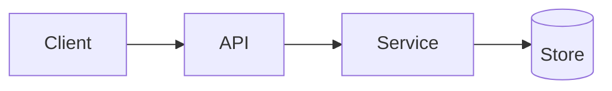

# Design: <Feature name>

- **Requirements:** [requirements.md](./requirements.md)
- **Reviewers:** <names>

## Overview
<How the solution works in 3–5 sentences.>

## Architecture
<Components, boundaries, and a Mermaid diagram if it helps.>

## Data model and data flow
- Entities and schema changes:
- Where Restricted or Confidential data flows, is stored, and is logged:

## Interfaces
- APIs, events, or CLI changes, with request and response shapes.

## Alternatives considered
| Option | Pros | Cons | Why not |
|---|---|---|---|

## Security and privacy
- Threats considered and mitigations:
- New secrets or permissions needed, and where they live:

## Testing strategy
- Unit / integration / e2e coverage mapped to requirement IDs.

## Rollout and rollback
- Feature flag, migration order, monitoring, rollback steps.

## Checklist
- [ ] Every requirement is addressed by a design element
- [ ] Security and data flow reviewed
- [ ] Rollback plan exists
